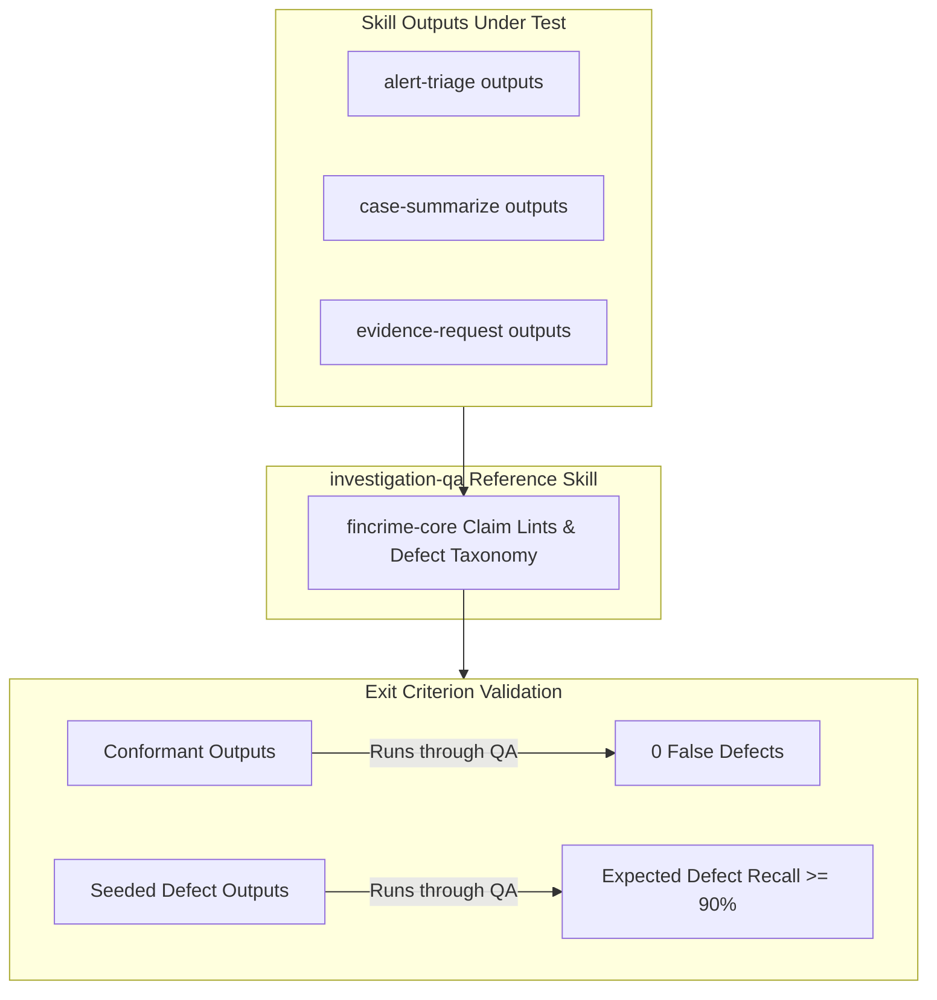

# Phase 3 Handoff — First Skills Specification & Architecture Baseline

## 1. Executive Summary & Repository Status

Following the completion of **Phase 0 (Architecture & Finding Contract)**, **Phase 1 (Core Skill Specification & CLI Tooling)**, and **Phase 2 (Knowledge Layer & `core-2026-10`)**, the `fincrime-skills` repository has transitioned from an architectural framework into an active, validated authoring ecosystem.

### Key Milestones Completed:
* **The Finding Contract (`fincrime/finding/1.0.0`):** Sealed normative schema, RFC 6901 JSON-pointer evidence reference grammar, closed-world evidence attribution model, and claim lints (R-1 through R-12).
* **The Zero-Dependency CLI (`fincrime-cli`):** Scaffolder (`fincrime new skill`), validator (`fincrime validate`), policy evaluator (`fincrime policy check/export`), and pack auditor (`fincrime knowledge validate/check`). Zero third-party dependencies at runtime; in-house `yamlite` parser verified against PyYAML.
* **The First Dated Knowledge Pack (`knowledge/packs/core-2026-10`):** 83 production-grade records (25 indicators, 8 typologies, 20 US regulations, 30 request-catalogue entries) with mandatory benign explanations, bias controls, paraphrased statutory definitions, and deterministic SHA-256 integrity checksums.
* **Graded Expiry & Promotion Gates (ADR-0006):** Offline promotion gate in CI that hard-blocks expired cited knowledge while gracefully warning on released skills (`MAINTENANCE_REQUIRED`).
* **Verification Status:** **398 passing tests** across `fincrime-core` and `fincrime-cli`, 100% schema parity across 16 instances, socket-blocked network isolation verified, and zero non-stdlib imports.

---

## 2. Phase 1 Summary: Core Skill Specification

Phase 1 established the formal interfaces and tooling necessary to author, validate, and test skills without requiring deep knowledge of the underlying engine internals.

### Deliverables & Architecture
1. **The CLI / Core Boundary (ADR-0010):**
   - `packages/fincrime-core`: Sealed engine containing the core contract validator, RFC 6901 pointer resolver, policy evaluator, and knowledge pack models. Maintains a zero-dependency trust boundary.
   - `packages/fincrime-cli`: User-facing developer and CI toolkit (`fincrime` command). Implements zero-dependency frontmatter parsing and subset YAML parsing (`fincrime_cli.yamlite`) with strict syntax boundaries (no anchors, aliases, or multi-docs).
2. **Contract Schemas:**
   - [`contracts/case-suite.schema.json`](../contracts/case-suite.schema.json): Governs evaluation case suites, enforcing empirical case mixes (minimum 60 cases for stable skills, ≥40% mixed cases, ≥15% negative expectations, and typology coverage).
   - [`contracts/case.schema.json`](../contracts/case.schema.json): Defines the individual evaluation unit, requiring discriminative test inputs, expected indicators, and negative assertions.
   - [`contracts/policy-set.schema.json`](../contracts/policy-set.schema.json): Separates exportable, firm-readable deterministic rules from agent procedural stage guards.
   - [`contracts/knowledge-pack-manifest.schema.json`](../contracts/knowledge-pack-manifest.schema.json): Normative manifest schema with per-record file digests and sorted canonical JSON checksums.
3. **Policy Engine Extensions:**
   - Extended rule definitions with `when` (artifact header gating), `require.any_of` (per-claim disjunction), regex `pattern` matching, and `negation_aware` evaluation.
   - Created `policies/default/policy-set.json` encoding baseline structural and epistemic claim controls (verified to produce zero violations on the golden artifact).
4. **Authoring Tooling:**
   - `fincrime new skill <name>`: Scaffolds a compliant skill directory structure (`SKILL.md`, `fincrime.skill.yaml`, starter case suite).
   - Complete guides published in [`docs/skill-authoring.md`](skill-authoring.md) and [`docs/jurisdiction-support.md`](jurisdiction-support.md).

---

## 3. Phase 2 Summary: Knowledge Layer & `core-2026-10`

Phase 2 delivered the factual substrate that skills depend on, backed by immutable packaging and automated expiry enforcement.

### Deliverables & Architecture
1. **The Core Knowledge Pack (`knowledge/packs/core-2026-10`):**
   - **83 Validated Records:**
     - **25 Indicators (`records/indicator/IND-*.json`):** All include mandatory `benign_explanations` (source material for the false-positive population and alternative hypotheses), full 10-item `prohibited_attributes` bias controls, `evidence_to_cite`, and behavioral attribute mappings. Standardized on canonical IDs (including `IND-STRUCT-THRESHOLD-PROXIMITY`).
     - **8 Typologies (`records/typology/TYP-*.json`):** Structuring/smurfing, trade-based money laundering (TBML), mule account networks, elder financial exploitation, shell company layering, real estate cash purchase layering, terrorist financing diversion, and account takeover laundering.
     - **20 US Regulatory Records (`records/regulatory/REG-*.json`):** BSA, FinCEN CTR rule (31 CFR 1010.311), FinCEN SAR rule (31 CFR 1020.320), CDD/UBO rule (31 CFR 1010.230), Travel Rule (31 CFR 1010.410(e)), OFAC Reporting, USA PATRIOT Act Sections 314(a) & 314(b), and Money Laundering Control Act. All definitions are strictly derived and paraphrased without verbatim statutory text.
     - **30 Request Catalogue Entries (`records/request/REQ-*.json`):** Standard RFC-style information request templates (e.g., POS settlement batches, source of wealth declarations, audited financials, UBO registries, bills of lading, bank statements).
2. **Reproducible Compilation Pipeline:**
   - Maintained in [`scripts/core_pack_data/`](../scripts/core_pack_data/) and compiled via [`scripts/build_core_pack.py`](../scripts/build_core_pack.py).
   - Automated orphan detection and cleaning prevents stale or renamed files from lingering in published packs.
   - Running `python scripts/build_core_pack.py --check` guarantees the committed pack bytes match the reviewed source data with zero drift.
3. **Graded Expiry Enforcement (ADR-0006):**
   - **Pack Promotion:** An expired record produces `pack_record_expired` with severity `error` under `--promotion`, blocking the gate. In release mode, it produces a `warn`.
   - **Skill Promotion & Decoupled Scope:**
     - A skill that explicitly cites records depends on those records: expired cited records hard-block promotion (`SKILL-KNOWLEDGE-EXPIRED`). Uncited expired records in the same pack produce a non-blocking disclosure warning (`SKILL-KNOWLEDGE-UNCITED-EXPIRED`).
     - A skill declaring a pack without specific citations (e.g. `investigation-qa`) is treated as a whole-pack dependent: any expired record in the pack blocks promotion.
     - Citing non-existent records immediately fails validation with `SKILL-RECORD-UNRESOLVED`.
   - **Artifact Validation:** `fincrime validate` automatically populates `known_indicator_ids` alongside `known_knowledge_ids`, strictly enforcing indicator existence rules.
4. **Offline CI & Expiry Bot:**
   - [`.github/workflows/ci.yml`](../.github/workflows/ci.yml) implements a network-free promotion gate using `git diff "origin/${{ github.base_ref }}...HEAD"` with `fetch-depth: 0`.
   - [`scripts/knowledge_expiry_bot.py`](../scripts/knowledge_expiry_bot.py) handles team maintainer handles (such as `@fincrime-maintainers`) by notifying via issue body mentions rather than invalid assignee calls, supported by an automated retry fallback.
   - Pinned by [`packages/fincrime-cli/tests/test_workflows.py`](../packages/fincrime-cli/tests/test_workflows.py) to ensure workflow structure and offline guarantees cannot regress.

---

## 4. Phase 3 Scope & Requirements: The First Skills

Phase 3 transitions `fincrime-skills` from specification and knowledge packaging to **live end-to-end skill execution**.

### Target Objectives (from `ROADMAP.md`):
> **Objective:** Three skills that work end to end:
> - `skills/alert-triage`
> - `skills/case-summarize`
> - `skills/evidence-request`
> - ≥ 60 cases each, with the required mix
>
> **Exit criterion:** Each validates, each has a case suite, and the `investigation-qa` skill finds the seeded defects in the others' outputs and no false defects in their good outputs.

### Detailed Skill Deliverables

#### 1. `skills/alert-triage`
* **Purpose:** Takes raw alerts and initial transaction/customer evidence, validates evidence inventory, identifies indicator matches from `core-2026-10`, forms balanced adverse and benign hypotheses, assesses risk under decisive evidence gaps, and produces a compliant triage finding document (`fincrime/finding/1.0.0`).
* **Artifact Type:** `triage_report`
* **Required Output Claims:** `frame`, `evidence_inventory`, `gaps`, `observation`, `indicator`, `hypothesis` (must include at least one `benign_reading` alongside any `adverse_reading`), `risk_assessment`, `recommendation`.
* **Prohibited Claims:** `decision` (autonomous disposition prohibited).
* **Declared Dependencies:**
  - `knowledge_pack: core-2026-10`
  - Explicit citations of structuring, velocity, or pass-through indicators (e.g., `IND-STRUCT-THRESHOLD-PROXIMITY`, `IND-FAST-MOVEMENT-PASS-THROUGH`, `IND-ROUND-AMOUNT-DEPOSIT-CLUSTER`).
  - Required policies: `POL-EVIDENCE-INVENTORY-FIRST`, `POL-BENIGN-HYPOTHESIS-REQUIRED`, `POL-NO-CRIMINALITY-CLAIMS`.

#### 2. `skills/case-summarize`
* **Purpose:** Synthesizes multi-account, multi-counterparty, complex transactional timelines into an investigative summary finding document without epistemic drift or overstated certainty.
* **Artifact Type:** `case_summary`
* **Required Output Claims:** `frame`, `evidence_inventory`, `timeline`, `observation`, `gaps`, `risk_assessment`, `recommendation`.
* **Key Invariants:** Every stated event in the timeline must anchor directly to RFC 6901 evidence pointers (`txn:*`, `doc:*`). No timeline event may introduce unsourced assertions.

#### 3. `skills/evidence-request`
* **Purpose:** Evaluates decisive evidence gaps identified during triage or investigation and generates structured, defensible information requests anchored to the request catalogue.
* **Artifact Type:** `request_dossier`
* **Required Output Claims:** `frame`, `gaps`, `observation`, `recommendation` (each recommendation must map directly to catalogue records like `REQ-POS-SETTLEMENT-BATCH`, `REQ-UBO-REGISTRY-PROOF`, `REQ-BANK-STATEMENTS-12M`).
* **Safety:** All requests that could affect a customer require `human_approval_required: true`.

---

## 5. Evaluation Case Suites & Mix Requirements

Each of the three skills must be accompanied by an evaluation case suite conforming to [`contracts/case-suite.schema.json`](../contracts/case-suite.schema.json) located in `skills/<skill-name>/evals/suites/<skill-name>/`.

### Requirements per Suite:
* **Case Count:** ≥ 60 cases per skill (180 cases across the three skills).
* **Case Mix Constraints:**
  - **Mixed Cases:** ≥ 40% of cases must belong to `benign`, `adversarial`, `missing_data`, or `contradictory` kinds.
  - **Negative Expectations:** ≥ 15% of cases must specify negative assertions (`forbidden_claim_classes`, `forbidden_indicators`, or `forbidden_strings` such as criminal liability assertions).
  - **Typology Coverage:** At least one benign case per typology covered by the suite (`min_benign_per_typology: true`).
* **Format:**
  - `suite.json`: Suite manifest declaring `requirements`, `typologies`, and the array of case entries.
  - `cases/<case-id>.json`: Individual cases conforming to [`contracts/case.schema.json`](../contracts/case.schema.json).

---

## 6. The Exit Criterion & Cross-Skill QA Gate

The exit criterion for Phase 3 requires empirical proof using the reference skill `investigation-qa`:

1. **Validation:** `fincrime validate skills/alert-triage`, `fincrime validate skills/case-summarize`, and `fincrime validate skills/evidence-request` must all exit with **0 errors**.
2. **Defect Detection on Flawed Outputs:** When seeded defect mutations are injected into the outputs (e.g., missing benign hypothesis, ungrounded recommendation, culpability assertion, or uncited indicator), `investigation-qa` must flag them accurately according to the defect taxonomy.
3. **Zero False Positives on Valid Outputs:** When evaluated against the compliant outputs of the three skills, `investigation-qa` must report **zero false defects**.

---

## 7. Execution Invariants for Phase 3

When executing Phase 3 tasks, all authors and agents must maintain the following repository invariants:
* **Stdlib-Only:** Neither `fincrime-core` nor `fincrime-cli` may import third-party packages at runtime. Run `python scripts/check_imports.py` to verify.
* **Deterministic Decision Functions:** No clocks, no network calls, no random generators inside decision functions. Always parameterize dates (`as_of`).
* **Air-Gap Safety:** All tests must pass with network sockets completely disabled via `python scripts/check_no_network.py`.
* **Execution Discipline (Rate Limit Defense):** For agent execution, batch file creation and test runs to remain strictly under the **20 requests per minute** ceiling.
