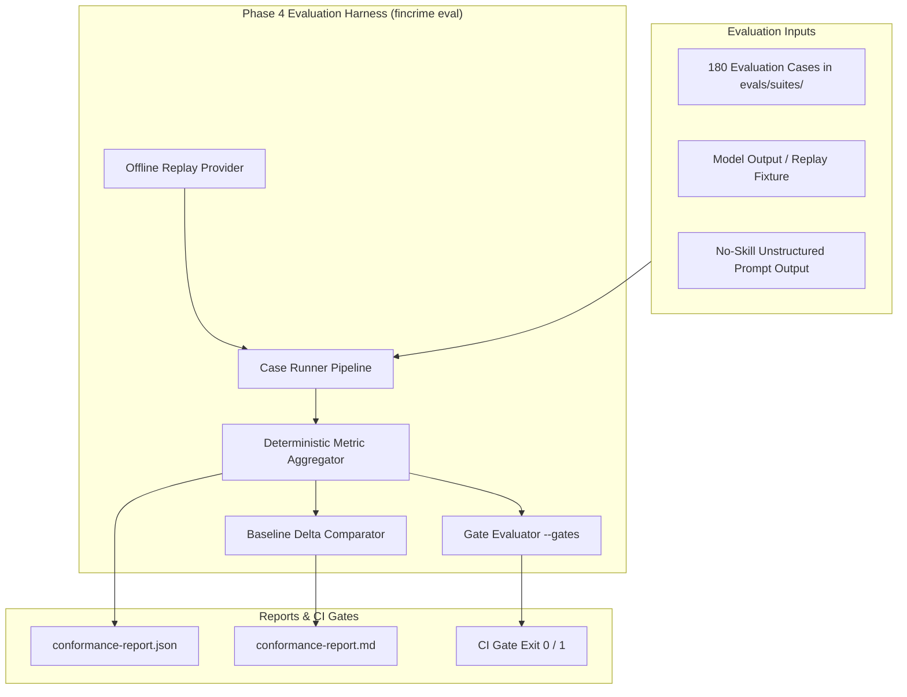

# Phase 4 Handoff — Evaluation Framework & Native Harness Baseline

## 1. Executive Summary & Repository Status

Following the completion of **Phase 0 (Architecture & Finding Contract)**, **Phase 1 (Core Skill Specification & CLI Tooling)**, **Phase 2 (Knowledge Layer & `core-2026-10`)**, and **Phase 3 (First Skills Specification, Hardening & Exit Criterion Proof)**, the `fincrime-skills` repository has transitioned into a fully functional, empirically verified skill ecosystem.

### Key Milestones Completed Across Phases 0–3:
* **The Sealed Finding Contract (`fincrime/finding/1.0.0`):** Canonical JSON Schema 2020-12 definition of the Evidence-Linked Finding, RFC 6901 pointer resolution grammar, closed-world evidence attribution model, and claim lints (R-1 through R-13).
* **The Zero-Dependency CLI (`fincrime-cli`):** Scaffolder (`fincrime new skill`), validator (`fincrime validate`), policy evaluator (`fincrime policy check/export`), and pack auditor (`fincrime knowledge validate/check`). Zero third-party dependencies at runtime; verified against reference implementations.
* **The First Dated Knowledge Pack (`knowledge/packs/core-2026-10`):** 83 production-grade records (25 indicators, 8 typologies, 20 US regulations, 30 request-catalogue entries) with mandatory benign explanations, bias controls, paraphrased statutory definitions, and deterministic SHA-256 integrity checksums.
* **The First Three Live Skills (`skills/`):**
  - `skills/alert-triage` (producing `triage_report`)
  - `skills/case-summarize` (producing `case_summary`)
  - `skills/evidence-request` (producing `request_dossier`)
  - Supported by reference skill `skills/investigation-qa` (producing `qa_result`).
* **180 Production Evaluation Cases:** 60 cases per skill generated programmatically via `scripts/generate_phase3_cases.py` (deterministic, byte-identical). All three suites meet the stable-skill bar: 67–68% mixed cases (≥40% floor), 100% negative expectations (≥15% floor), and ≥2 benign lookalikes per covered typology.
* **Rule `R-1b` Timeline Evidence Anchoring:** Timeline entries in `case_summary` findings are verified at runtime; unresolvable RFC 6901 pointers trigger `unsupported_claim` defects and block validation.
* **Formal Contract Governance (ADR-0011):** `request_dossier` added to `contracts/finding.schema.json` and `requests` added to `contracts/skill-manifest.schema.json` as additive, backwards-compatible amendments within the `1.x` axis.
* **Exit Criterion Proven:** 43 tests in `packages/fincrime-cli/tests/test_phase3_exit_criterion.py` proving **0 false defects** on golden artifacts and **100% defect recall (12/12)** on seeded mutations.
* **Verification Status:** **398 passing tests**, 16 schema parity instances, zero non-stdlib imports, 100% socket air-gap safety, and clean git history across three atomic commits (`0af1a74`, `80ab5d3`, `52a85fd`).

---

## 2. Phase 1 Summary: Core Skill Specification

Phase 1 established the formal interfaces and tooling necessary to author, validate, and test skills without requiring deep knowledge of the underlying engine internals.

### Deliverables & Architecture
1. **The CLI / Core Boundary (ADR-0010):**
   - `packages/fincrime-core`: Sealed engine containing the core contract validator, RFC 6901 pointer resolver, policy evaluator, and knowledge pack models. Maintains a zero-dependency trust boundary.
   - `packages/fincrime-cli`: User-facing developer and CI toolkit (`fincrime` command). Implements zero-dependency frontmatter parsing and subset YAML parsing (`fincrime_cli.yamlite`) with strict syntax boundaries.
2. **Contract Schemas:**
   - [`contracts/case-suite.schema.json`](../contracts/case-suite.schema.json): Governs evaluation case suites, enforcing empirical case mixes (default 60 cases for stable skills, ≥40% mixed cases, ≥15% negative expectations, and typology coverage).
   - [`contracts/case.schema.json`](../contracts/case.schema.json): Defines the individual evaluation unit, requiring discriminative test inputs, expected indicators, and negative assertions.
   - [`contracts/policy-set.schema.json`](../contracts/policy-set.schema.json): Separates exportable, firm-readable deterministic rules from agent procedural stage guards.
   - [`contracts/knowledge-pack-manifest.schema.json`](../contracts/knowledge-pack-manifest.schema.json): Normative manifest schema with per-record file digests and sorted canonical JSON checksums.
3. **Policy Engine Extensions:**
   - Extended rule definitions with `when` (artifact header gating), `require.any_of` (per-claim disjunction), regex `pattern` matching, and `negation_aware` evaluation.
   - Created `policies/default/policy-set.json` encoding baseline structural and epistemic claim controls (verified to produce zero violations on the golden artifact).
4. **Authoring Tooling:**
   - `fincrime new skill <name>`: Scaffolds a compliant skill directory structure (`SKILL.md`, `fincrime.skill.yaml`, starter case suite).
   - Complete guides published in [`docs/skill-authoring.md`](skill-authoring.md) and [`docs/jurisdiction-support.md`](jurisdiction-support.md).

---

## 3. Phase 2 Summary: Knowledge Layer & `core-2026-10`

Phase 2 delivered the factual substrate that skills depend on, backed by immutable packaging and automated expiry enforcement.

### Deliverables & Architecture
1. **The Core Knowledge Pack (`knowledge/packs/core-2026-10`):**
   - **83 Validated Records:**
     - **25 Indicators (`records/indicator/IND-*.json`):** Mandatory `benign_explanations`, full 10-item `prohibited_attributes` bias controls, `evidence_to_cite`, and behavioral attribute mappings.
     - **8 Typologies (`records/typology/TYP-*.json`):** Structuring/smurfing, trade-based money laundering (TBML), mule account networks, elder financial exploitation, shell company layering, real estate cash purchase layering, terrorist financing diversion, and account takeover laundering.
     - **20 US Regulatory Records (`records/regulatory/REG-*.json`):** BSA, CTR rule (31 CFR 1010.311), SAR rule (31 CFR 1020.320), CDD/UBO rule (31 CFR 1010.230), Travel Rule (31 CFR 1010.410(e)), OFAC Reporting, USA PATRIOT Act Sections 314(a) & 314(b), and Money Laundering Control Act. Derived and paraphrased without verbatim statutory text.
     - **30 Request Catalogue Entries (`records/request/REQ-*.json`):** Standard information request templates (POS settlement batches, source of wealth declarations, audited financials, UBO registries, bills of lading, bank statements).
2. **Reproducible Compilation Pipeline:**
   - Maintained in [`scripts/core_pack_data/`](../scripts/core_pack_data/) and compiled via [`scripts/build_core_pack.py`](../scripts/build_core_pack.py).
   - Running `python scripts/build_core_pack.py --check` guarantees the committed pack bytes match the reviewed source data with zero drift.
3. **Graded Expiry Enforcement (ADR-0006):**
   - Promotion gate in CI hard-blocks expired cited knowledge under `--promotion` while gracefully warning on released skills (`MAINTENANCE_REQUIRED`).
   - Decoupled scope: uncited expired records in the same pack produce a non-blocking disclosure warning.
4. **Offline CI & Expiry Bot:**
   - [`.github/workflows/ci.yml`](../.github/workflows/ci.yml) implements an offline promotion gate.
   - [`scripts/knowledge_expiry_bot.py`](../scripts/knowledge_expiry_bot.py) monitors pack freshness and drafts refresh notices.

---

## 4. Phase 3 Summary: The First Skills & Hardening Baseline

Phase 3 transitioned `fincrime-skills` from specification and packaging into live, production-grade skill implementations, fully hardened and verified.

### Deliverables & Architecture
1. **Three Production Skill Packages:**
   - **`skills/alert-triage`:** Ingests alerts, builds `evidence_inventory`, evaluates indicator matches from `core-2026-10`, enforces mandatory `benign_reading` alongside `adverse_reading`, and outputs a `triage_report`. Prohibits autonomous `decision` claims.
   - **`skills/case-summarize`:** Ingests multi-party transactional evidence, constructs chronological timelines anchored to RFC 6901 pointers (`txn:*`, `doc:*`), and outputs a `case_summary` without epistemic drift.
   - **`skills/evidence-request`:** Ingests decisive gaps, anchors recommendations to request catalogue entries (`REQ-*`), requires `human_approval_required: true` for customer actions, and outputs a `request_dossier`.
2. **180 Evaluation Cases (60 per skill):**
   - Compiled by [`scripts/generate_phase3_cases.py`](../scripts/generate_phase3_cases.py).
   - Mix: 67–68% mixed cases (benign, adversarial, missing data, contradictory).
   - Negative expectations: 100% of cases carry at least one negative assertion (`forbidden_claim_classes`, `forbidden_indicators`, `forbidden_strings`, or `expected_escalation: false`).
   - Typology coverage: ≥2 benign cases per covered typology.
   - Manifest declared floor: `min_cases: 60`, `case_count_min: 60` (clearing the stable gate).
3. **Architectural Remediations Incorporated:**
   - **Rule `R-1b` (Timeline Anchoring):** Added to `fincrime_core.validate.claim_lints` and `validator`. Every timeline pointer must resolve against the `SourceIndex`.
   - **Manifest Schema Normalization:** Added `knowledge.requests` to `contracts/skill-manifest.schema.json`. Removed workaround overloading of `knowledge.scenarios`.
   - **ADR-0011 Governance:** Formalized contract additions (`request_dossier` in finding schema and `requests` in manifest schema) in [`docs/adr/0011-request-dossier-and-manifest-catalogue-binding.md`](adr/0011-request-dossier-and-manifest-catalogue-binding.md).
   - **Cross-Skill QA Gate:** 43 tests in [`packages/fincrime-cli/tests/test_phase3_exit_criterion.py`](../packages/fincrime-cli/tests/test_phase3_exit_criterion.py) proving zero false defects and 100% defect recall on seeded defects.
   - **Git Staging:** Clean working tree organized into three atomic commits: `0af1a74` (Phase 1), `80ab5d3` (Phase 2), and `52a85fd` (Phase 3).

---

## 5. Phase 4 Scope & Requirements: The Evaluation Framework

Phase 4 delivers **the actual moat** of the project: the native evaluation harness that executes skills against evaluation suites, scores outputs deterministically, compares models against baselines, and enforces regression gates in CI.

### Target Objectives (from `ROADMAP.md`):
> **Objective:** The actual moat.
> - The native harness: case loader, provider adapters, deterministic scorers, metric aggregation, gate evaluation, report rendering
> - The **replay** provider, so the golden path runs offline with no API key
> - The **no-skill baseline** runner and the delta table
> - Multi-seed noise methodology (3 seeds, 2×SE band, "no measurable effect")
> - The published conformance report
>
> **Exit criterion:** A published report with real numbers, a reproducible replay path, and a CI gate that actually blocks a regression.

---

### Detailed Phase 4 Components

#### 1. The Native Evaluation Harness (`packages/fincrime-eval` or CLI `fincrime eval`)
* **Case Loader & Execution Runner:** Loads cases from `evals/suites/<skill>/`, executes the skill under test, and captures output finding documents.
* **Provider Adapters:**
  - `ReplayProvider`: Replays pre-recorded, committed candidate findings for test cases offline. Requires zero network sockets and zero external API keys. This is the primary driver for GitHub Actions CI.
  - `ModelProvider`: Interface for running real model APIs (e.g., Anthropic, Gemini, OpenAI) to generate candidate findings during local evaluation runs.
  - `MockProvider`: Injects controlled mutations for defect recall and noise benchmarking.

#### 2. Deterministic Scorers & Metric Aggregation
Computes the exact metrics defined in `contracts/case-suite.schema.json` and `fincrime.skill.yaml`:
* **`schema_validity`:** Fraction of cases whose output strictly satisfies `contracts/finding.schema.json` (gate: 1.0).
* **`evidence_attribution_accuracy`:** Fraction of evidence citations that correctly resolve to facts in the evidence set (gate: ≥0.98).
* **`unsupported_claim_rate`:** Fraction of evidence-bearing claims lacking valid citations (gate: ≤0.02).
* **`required_field_compliance`:** Presence of all `required_claims` and absence of `prohibited_claims` (gate: 1.0).
* **`policy_pass_rate`:** Pass rate against enforceable firm policies in `policies/default/policy-set.json` (gate: 1.0).
* **`expected_defect_recall`:** Recall rate when evaluating intentionally defective artifacts (gate: ≥0.90).
* **`false_defect_rate`:** Defect rate reported when evaluating compliant golden artifacts (gate: ≤0.05).

#### 3. The "No-Skill" Baseline Runner & Delta Table
* Runs identical case evidence sets through an unconstrained, zero-shot model prompt without the FinCrime skill system.
* Generates a comparative **Delta Table** showing:
  - Hallucination reduction (unsupported claim rate drop).
  - Elimination of culpability conclusions (R-6 compliance).
  - Structural completeness (presence of falsifiers, benign hypotheses, and human decision requests).

#### 4. Multi-Seed Noise Methodology
* Evaluates non-deterministic model runs across 3 distinct seeds.
* Calculates standard errors (SE) and establishes a 2×SE significance band.
* Proves that performance improvements are statistically robust rather than sampling noise.

#### 5. Conformance Report Rendering
* Generates `conformance-report.json` and a clean, firm-readable `conformance-report.md`.
* Tabulates per-skill gate evaluations, score breakdowns by case kind (golden, benign, adversarial, missing data, contradictory), and the baseline delta table.

---

## 6. Exit Criterion for Phase 4

The completion of Phase 4 requires:
1. **Reproducible Offline Replay:** Running `fincrime eval --replay` executes all 180 cases offline with network sockets blocked (`scripts/check_no_network.py`) and passes in CI.
2. **Gate Enforcement:** Running `fincrime eval --gates` evaluates candidate runs against the thresholds declared in each skill's `fincrime.skill.yaml` and exits 1 if any threshold fails.
3. **Published Benchmark Report:** A committed `conformance-report.md` containing empirical numbers from real runs across the four skills (`investigation-qa`, `alert-triage`, `case-summarize`, `evidence-request`), including baseline deltas and standard error bands.

---

## 7. Execution Invariants for Phase 4

When executing Phase 4 tasks, all authors and agents must maintain the following repository invariants:
* **Stdlib-Only Core & CLI:** Zero third-party dependencies at runtime. Run `python scripts/check_imports.py` to verify.
* **Air-Gap Safety:** The evaluation harness must support complete socket-blocked execution via `python scripts/check_no_network.py`.
* **Deterministic Dates:** Always parameterize dates (`as_of`). No clocks or pseudo-random generators in decision or scoring paths.
* **Batch Execution Discipline (API Quota Defense):** When operating with agent workflows, execute tasks in discrete batches to remain strictly under the **20 requests per minute** and **50 requests per day** quota.
